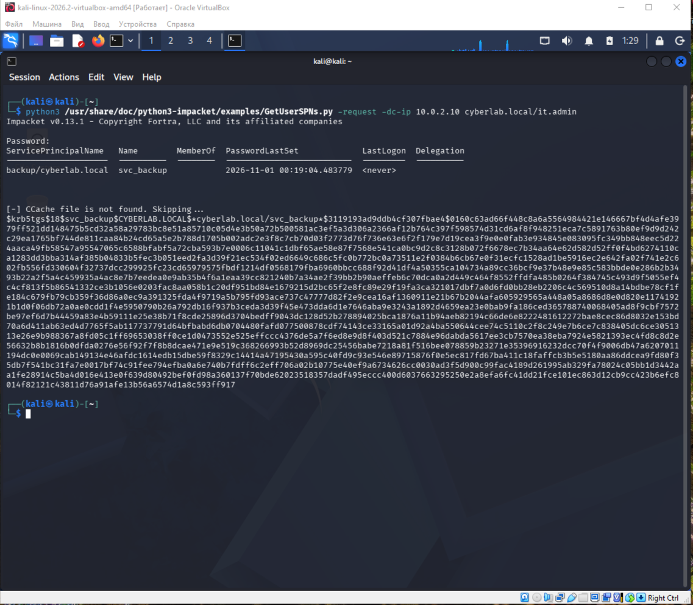
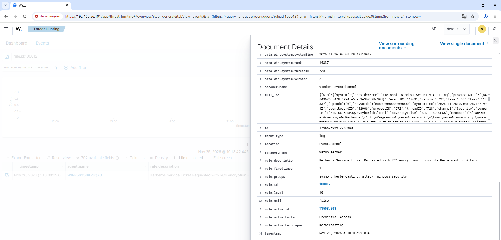
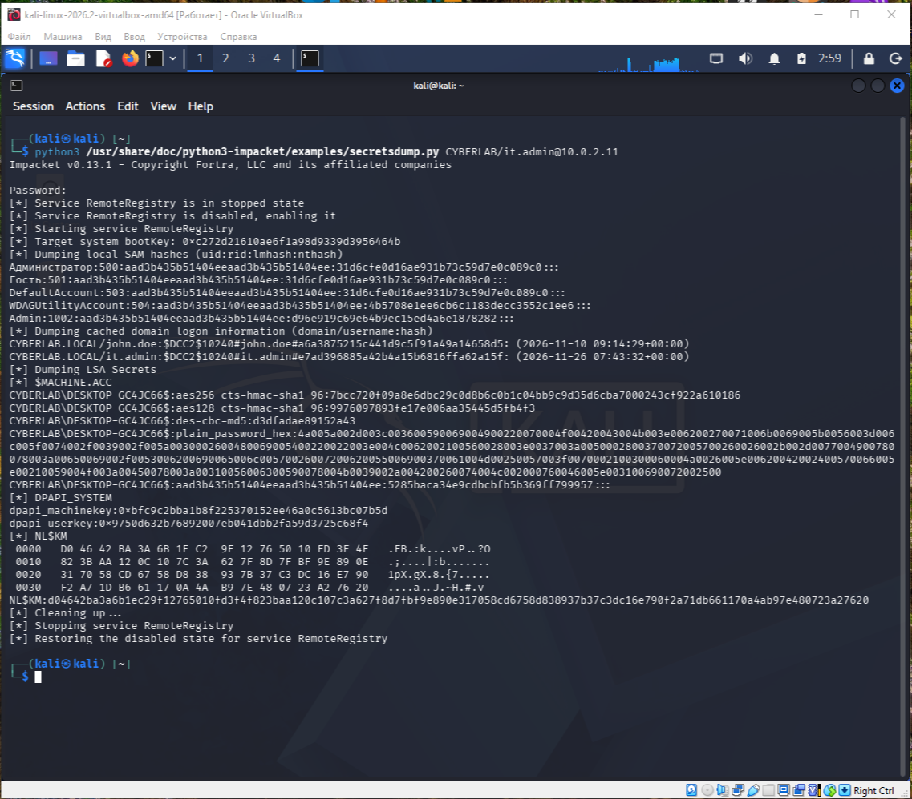
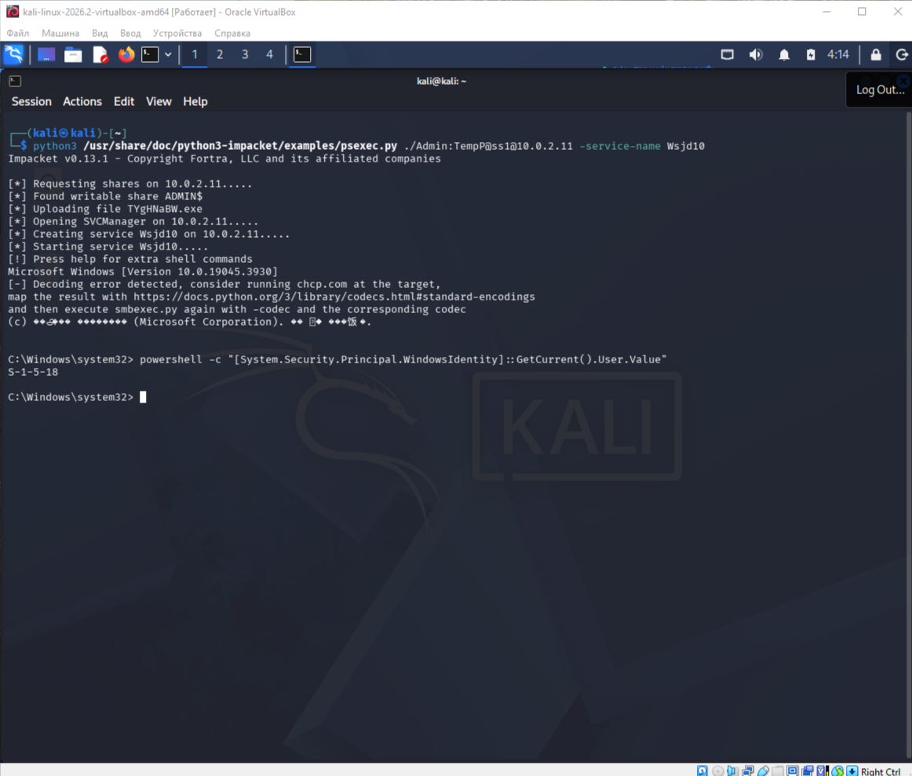
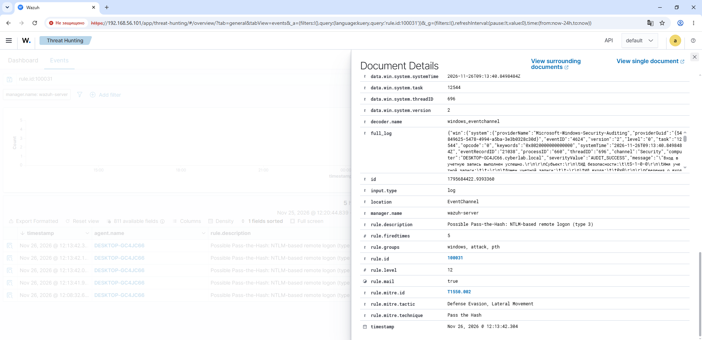

# 🛡️ Active Directory Purple Teaming Lab with Wazuh SIEM

A hands-on Purple Team project simulating real-world Active Directory attacks and developing custom detection rules in Wazuh SIEM, mapped to the MITRE ATT&CK framework.

## 📋 Project Overview

This project demonstrates an end-to-end Purple Teaming methodology:

1. **Red Team**: Executing realistic AD attacks (Kerberoasting, Pass-the-Hash).
2. **Blue Team**: Ingesting Windows Event Logs & Sysmon into Wazuh SIEM.
3. **Purple Team**: Analyzing attack artifacts and engineering custom detection rules to generate high-fidelity alerts.

## 🏗️ Lab Architecture

- **Domain Controller**: Windows Server 2022 (`10.0.2.10`)
- **Target Endpoint**: Windows 10 (`10.0.2.11`)
- **Attacker Machine**: Kali Linux (`10.0.2.12`)
- **SIEM / Detection Engine**: Wazuh Manager on Amazon Linux 2023 (`10.0.2.20`)

## ⚔️ Attack Scenarios & Detections

### 1. Reconnaissance & Discovery

- **Attack**: Enumerating domain users and groups via `net user /domain`.
- **Detection**: Wazuh built-in Sysmon rules (ID: 92031, 92033) detecting discovery activity.
- **MITRE ATT&CK**: T1087.002 (Account Discovery: Domain Account)

### 2. Kerberoasting

- **Attack**: Requesting a TGS ticket for a service account (`svc_backup`) with RC4-HMAC encryption using Impacket's `GetUserSPNs.py` to capture the hash for offline cracking.
- **Detection**: Custom Wazuh rule analyzing Event ID 4769, specifically looking for `ticketOptions: 0x40810000` (RC4 request).
- **MITRE ATT&CK**: T1558.003 (Steal or Forge Kerberos Tickets: Kerberoasting)

### 3. Credential Dumping

- **Attack**: Extracting local SAM hashes and domain credentials from Windows 10 using Impacket's `secretsdump.py`.
- **Detection**: Windows Event Log monitoring for suspicious remote registry access and credential extraction patterns.
- **MITRE ATT&CK**: T1003.001 (OS Credential Dumping: LSASS Memory)

### 4. Pass-the-Hash (PtH)

- **Attack**: Using the extracted NTLM hash to authenticate and execute commands remotely via `psexec.py`, achieving `NT AUTHORITY\SYSTEM` access without knowing the plaintext password.
- **Detection**: Custom Wazuh child rule elevating the built-in rule 92652 to a critical level (12) upon detecting NTLM-based remote logons indicative of PtH.
- **MITRE ATT&CK**: T1550.002 (Use Alternate Authentication Material: Pass the Hash)

---

## 📸 Proof of Execution

### 🔴 Kerberoasting Attack (T1558.003)

**Step 1: Capturing the Kerberos TGS hash**

_Tool: `GetUserSPNs.py` from Impacket. Target: `svc_backup` service account. Result: Captured `$krb5tgs$18$` hash for offline cracking._

**Step 2: SIEM Detection — Custom Rule 100012 (Level 10 - High)**

_Wazuh detected the RC4-HMAC ticket request (`ticketOptions: 0x40810000`) and triggered a high-severity alert with MITRE ATT&CK mapping._

### 🔴 Credential Dumping (T1003.001)

**Extracting NTLM hashes from Windows 10**

_Tool: `secretsdump.py` from Impacket. Extracted local SAM hashes including the Admin account (SID 1002) used for the subsequent PtH attack._

### 🔴 Pass-the-Hash Attack (T1550.002)

**Step 1: Remote shell via psexec.py — NT AUTHORITY\SYSTEM**

_Tool: `psexec.py` from Impacket. Used the extracted NTLM hash to authenticate as local Admin without the plaintext password. Achieved full SYSTEM shell (`SID S-1-5-18`) on `DESKTOP-GC4JC66`.

**Step 2: SIEM Detection — Custom Rule 100031 (Level 12 - Critical)**

_Wazuh detected 4 NTLM-based remote logons and triggered a critical-severity alert with MITRE ATT&CK mapping to T1550.002._

---

## ⚙️ Custom Detection Rules

### Kerberoasting Detection (`rules/kerberoasting_detection.xml`)

    <group name="sysmon,kerberoasting,attack,windows_security,">
      <rule id="100012" level="10">
        <if_sid>60106</if_sid>
        <field name="win.system.eventID">^4769$</field>
        <field name="win.eventdata.ticketOptions">0x40810000</field>
        <description>Kerberos Service Ticket Requested with RC4 encryption - Possible Kerberoasting Attack</description>
        <mitre>
          <id>T1558.003</id>
        </mitre>
      </rule>
    </group>

### Pass-the-Hash Detection (`rules/pass_the_hash_detection.xml`)

Child rule of built-in 92652; elevates NTLM-based remote logons to level 12. Full XML in [`rules/pass_the_hash_detection.xml`](rules/pass_the_hash_detection.xml).

---

## ✅ Validation plan

| # | Test (attack / benign) | Expected alert | Result |
|---|------------------------|----------------|--------|
| 1 | `GetUserSPNs.py` request TGS for `svc_backup` (RC4-HMAC) | 100012, level 10 | ✅ detected |
| 2 | `secretsdump.py` against Windows 10 | credential-dumping telemetry (remote registry / SAM) | ✅ detected |
| 3 | `psexec.py -hashes :<NTLM>` remote SYSTEM shell | 100031, level 12 | ✅ detected |
| 4 | Benign: normal domain logon (Kerberos AES) from Win10 | NO 100012 / 100031 | ✅ no alert |

## 🧠 Lessons learned

- **Kerberoasting fidelity:** rule keys on `ticketOptions: 0x40810000` (RC4-HMAC) in Event 4769. Legitimate AES requests (`0x40810010`) do NOT fire → low false-positive rate.
- **PtH severity separation:** child rule elevates built-in 92652 to level 12 only on NTLM-based remote logons; normal Kerberos logons stay at base severity.
- **Chain correlation:** the same source IP across 4769 → 4624 (type 3) → 7045 lets you reconstruct the intrusion timeline (Kerberoast → dump → PtH).
- **Lab hygiene:** isolated host-only network; hashes cracked offline only inside the lab.

## 📸 Evidence gallery

**Kerberoasting (T1558.003)** — attack + custom alert 100012:

**Credential dumping (T1003.001)** — secretsdump output:

**Pass-the-Hash (T1550.002)** — SYSTEM shell + custom alert 100031:

---

## 📌 Project status

✅ Completed: lab deployment, AD attack simulation (Kerberoasting, credential dumping, PtH), custom detection rules, MITRE mapping, benign/malicious validation, evidence collection.

## ⚠️ Disclaimer

All attacks are performed in an isolated, closed VirtualBox host-only network for educational purposes only. Credentials and hashes exist solely inside the lab.

## 🔗 Related projects

- [MITRE ATT&CK Detection Coverage](https://github.com/Assem8ler/mitre-attack-detection-coverage)
- [Wazuh SIEM Fundamentals](https://github.com/Assem8ler/wazuh-siem-fundamentals)
